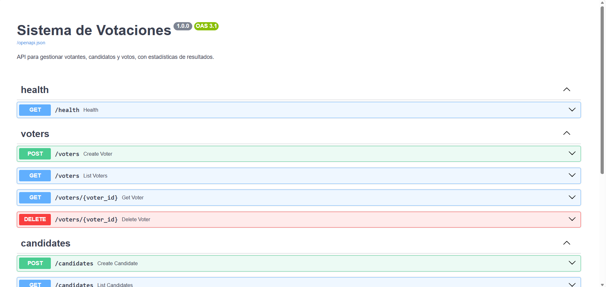
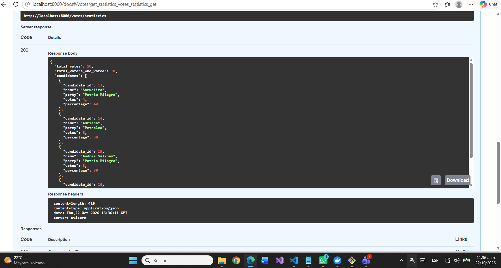

# Sistema de Votaciones

API REST para registrar votantes y candidatos, emitir votos (uno por votante) y consultar estadísticas de resultados.
Construida con FastAPI, SQLAlchemy 2 y PostgreSQL 16.

## Requisitos

Solo **Docker** (Docker Desktop en Windows/macOS). No hace falta Python ni crear ningún `.env`.

## Cómo ejecutar

```bash
git clone <url-del-repo>
cd sistema-votaciones-new-inntech
docker compose up --build
```

- Swagger (documentación interactiva): <http://localhost:8000/docs>
- Health check: <http://localhost:8000/health>

La base de datos se crea sola la primera vez que arranca el volumen, a partir de [`db/schema.sql`](db/schema.sql).
Para empezar de cero: `docker compose down -v`.

## Ejemplos de uso

Los ejemplos usan `curl` con sintaxis de bash (Linux, macOS, Git Bash). **En PowerShell** hay que llamar a `curl.exe` (no al alias `curl`), y lo más fiable es pasar el JSON por la entrada estándar:

```powershell
'{"name":"Ana","email":"ana@mail.com"}' | curl.exe -X POST http://localhost:8000/voters -H "Content-Type: application/json" -d "@-"
```

Swagger (`/docs`) permite probar todos los endpoints sin usar la terminal.

```bash
# Votantes
curl -X POST localhost:8000/voters -H "Content-Type: application/json" -d '{"name":"Ana","email":"ana@mail.com"}'
curl "localhost:8000/voters?limit=10&offset=0&has_voted=false&name=an"
curl localhost:8000/voters/1
curl -X DELETE localhost:8000/voters/1

# Candidatos (party es opcional)
curl -X POST localhost:8000/candidates -H "Content-Type: application/json" -d '{"name":"Luis","email":"luis@mail.com","party":"Partido Azul"}'
curl "localhost:8000/candidates?party=partido%20azul&name=lu"
curl localhost:8000/candidates/2
curl -X DELETE localhost:8000/candidates/2

# Votos
curl -X POST localhost:8000/votes -H "Content-Type: application/json" -d '{"voter_id":1,"candidate_id":2}'
curl localhost:8000/votes
curl localhost:8000/votes/statistics
```

| Endpoint | Éxito | Errores |
|---|---|---|
| `POST /voters`, `POST /candidates` | 201 | 409 email ya registrado (en cualquier rol), 422 datos inválidos |
| `GET /voters`, `GET /candidates` | 200 | 422 parámetros inválidos |
| `GET /voters/{id}`, `GET /candidates/{id}` | 200 | 404 |
| `DELETE /voters/{id}` | 204 | 404, 409 si ya votó |
| `DELETE /candidates/{id}` | 204 | 404, 409 si tiene votos |
| `POST /votes` | 201 | 404 votante o candidato inexistente, 409 ya votó, 422 |
| `GET /votes`, `GET /votes/statistics`, `GET /health` | 200 | — |

Los errores de negocio tienen la forma `{"detail": "<mensaje>", "code": "<CODIGO>"}` con códigos `NOT_FOUND`, `EMAIL_ALREADY_REGISTERED`, `ALREADY_VOTED` y `RESOURCE_IN_USE`.

Las listas aceptan `limit` (por defecto 50, máximo 100) y `offset`. Votantes filtran por `has_voted` y `name`; candidatos por `party` (exacto) y `name` (parcial, sin distinguir mayúsculas).

## Estadísticas

`GET /votes/statistics` tras cargar los datos de demostración:

```json
{
  "total_votes": 5,
  "total_voters_who_voted": 5,
  "candidates": [
    {"candidate_id": 7, "name": "Luis Martínez", "party": "Partido Azul", "votes": 3, "percentage": 60.0},
    {"candidate_id": 8, "name": "Marta López", "party": null, "votes": 2, "percentage": 40.0},
    {"candidate_id": 9, "name": "Pablo Herrera", "party": "Partido Verde", "votes": 0, "percentage": 0.0}
  ]
}
```

Para cargar esos datos con la API levantada: `python scripts/seed_demo.py` (solo usa la librería estándar).

### Capturas

| Swagger | Estadísticas |
|---|---|
|  |  |

## Tests

Los tests usan una base PostgreSQL real (`votaciones_test`, creada por [`db/init/`](db/init/)), no SQLite, para probar de verdad las FK compuestas, los `CHECK` y la concurrencia.

```powershell
docker compose up -d db
py -3.12 -m venv .venv
.\.venv\Scripts\Activate.ps1
pip install -r requirements-dev.txt
pytest
```

Si el volumen de la base se creó antes de existir `db/init/`, recréalo con `docker compose down -v`.

## Desarrollo local (API fuera de Docker)

Con la `.venv` activada como arriba:

```powershell
docker compose up -d db
uvicorn app.main:app --reload
```

La configuración se lee de variables de entorno o de un `.env` opcional; [`.env.example`](.env.example) documenta las variables y sus valores por defecto.

## Decisiones de diseño y supuestos

Detalle en [`docs/DECISIONES.md`](docs/DECISIONES.md) y explicación de la arquitectura en [`docs/ARQUITECTURA.md`](docs/ARQUITECTURA.md). En resumen:

- Arquitectura en capas: routers → services → repositories → models. Los services controlan la transacción y lanzan excepciones de dominio que se traducen a HTTP en un único sitio.
- Una tabla `persons` con email único y rol, y tablas `voters` / `candidates` enlazadas por una FK compuesta `(person_id, role)`: la base de datos impide que alguien sea votante y candidato a la vez.
- El `id` de votantes y candidatos es el de `persons`, por lo que los ids se comparten entre ambos recursos.
- El email es obligatorio, se normaliza a minúsculas y es único entre todos los roles.
- El voto es una transacción: INSERT en `votes`, `UPDATE` condicional de `has_voted` y `votes = votes + 1` en el candidato. El `UNIQUE` de `votes.voter_id` es la barrera final ante votos simultáneos.
- Borrados con `ON DELETE RESTRICT`: no se puede borrar a quien ya votó ni a un candidato con votos.
- Las estadísticas se calculan desde la tabla `votes`, que es la fuente de verdad.
- El esquema se crea con `db/schema.sql` al iniciar el contenedor, sin `create_all` ni migraciones.

## Mejoras futuras

- Autenticación (JWT) y roles de administración para altas y borrados.
- Migraciones con Alembic en lugar de un script de inicio.
- Paginación con total de resultados (cabeceras o sobre de respuesta) y paginación de `GET /votes`.
- Varias elecciones o votaciones, con fechas de apertura y cierre.
- Logs estructurados y métricas.
