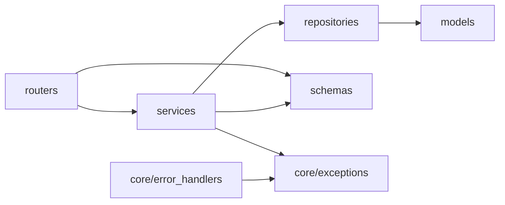
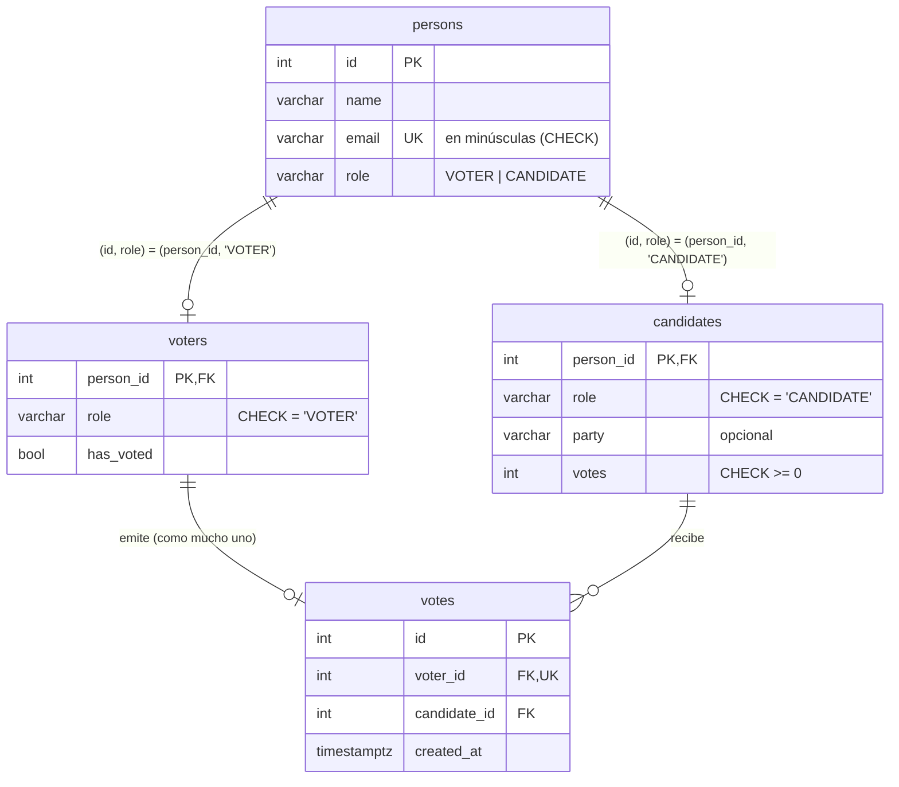
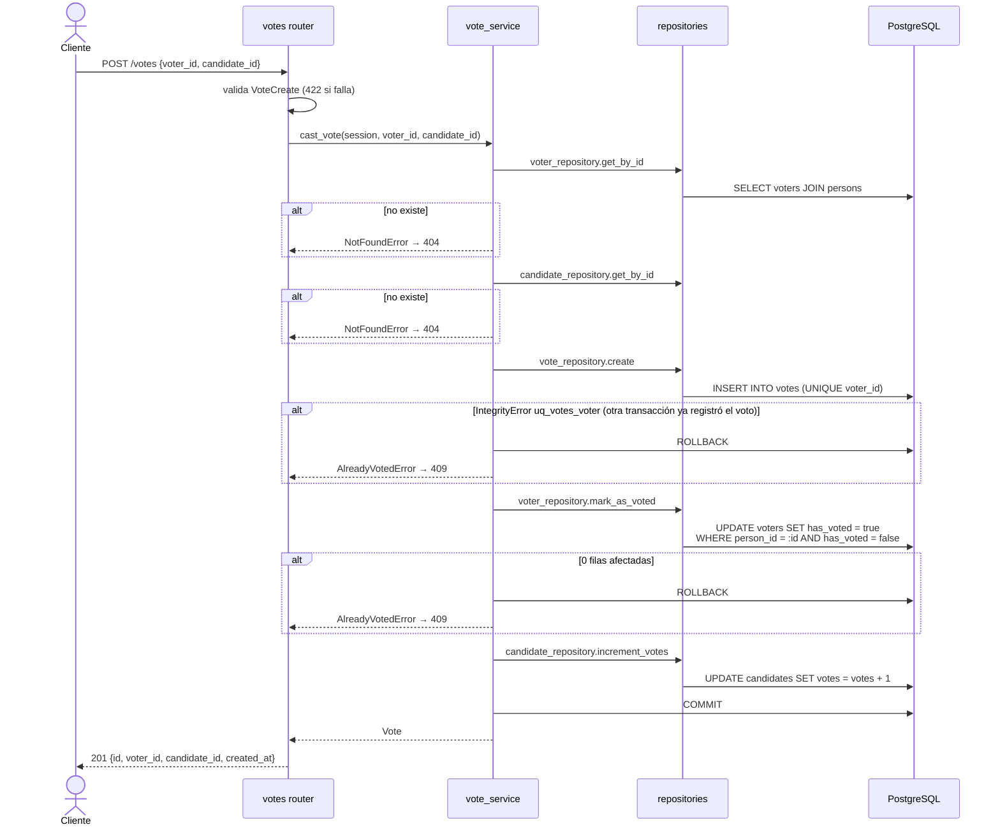
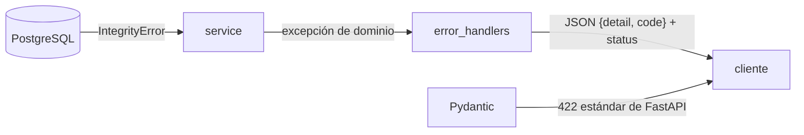

# Arquitectura

Este documento explica cómo está organizado el código, cómo viaja una petición por las capas y por qué cada decisión importante es la que es. El registro breve de decisiones está en [DECISIONES.md](DECISIONES.md).

## 1. Capas y responsabilidades

```
app/
  main.py               crea la app, registra manejadores de errores y routers
  core/                 configuración, sesión de BD, excepciones de dominio y su traducción a HTTP
  api/                  routers HTTP, dependencia de sesión y parámetros de paginación
  schemas/              contratos Pydantic de entrada y salida
  services/             reglas de negocio y control de la transacción
  repositories/         consultas e inserciones sobre la sesión recibida
  models/               mapeo SQLAlchemy de las tablas y constantes (roles, nombres de restricciones)
```

| Capa | Hace | No hace |
|---|---|---|
| **Routers** (`app/api/routers`) | Recibir HTTP, validar con schemas, elegir el código de estado, convertir modelos a schemas de salida | Reglas de negocio, consultas, `commit` |
| **Schemas** (`app/schemas`) | Definir y validar contratos (recortar el nombre, normalizar el email) | Acceder a la base de datos |
| **Services** (`app/services`) | Reglas de negocio, orquestar repositories, `commit`/`rollback`, traducir `IntegrityError` a excepciones de dominio | Importar FastAPI o conocer códigos HTTP |
| **Repositories** (`app/repositories`) | `select`, `insert`, `update`, `delete` y `flush` | `commit` o decisiones de negocio |
| **Models** (`app/models`) | Mapear tablas, incluidas FK compuestas y `CHECK` | Lógica |

### Regla de dependencias



Las flechas solo van hacia la derecha. Un service nunca importa un router ni FastAPI, y un repository nunca hace `commit`. Así:

- Los services se pueden probar o reutilizar sin HTTP. El test de concurrencia llama a `vote_service.cast_vote` directamente desde varios hilos.
- La transacción tiene un único dueño, el service. Si el repository hiciera `commit`, una operación de varios pasos como el voto podría quedar a medias.

### La sesión de base de datos

`app/core/database.py` crea el `engine` y una fábrica de sesiones. `get_db` abre una sesión por petición y la cierra al terminar. Los routers la reciben con `Depends` (alias `DbSession` en `app/api/dependencies.py`) y la pasan al service. No hay sesiones globales: cada petición trabaja aislada, y los tests pueden sustituir `get_db` por una sesión contra la base de pruebas.

## 2. Modelo de datos



El diagrama entidad-relación original está en [img/mer.png](img/mer.png).

### Por qué una tabla `persons` y una FK compuesta

El requisito clave es que **nadie sea votante y candidato a la vez**. Con dos tablas independientes (`voters` y `candidates`, cada una con su email) habría que comprobarlo en Python, y dos peticiones simultáneas podrían colarse entre la comprobación y el insert.

La solución reparte el trabajo en tres restricciones de la base de datos:

1. `persons.email` es `UNIQUE`: un email solo existe una vez, sea cual sea el rol. Esto cubre también las peticiones simultáneas, porque la segunda falla al insertar.
2. `persons.role` indica el único rol que puede tener esa persona, y `UNIQUE (id, role)` crea el destino de una FK compuesta.
3. `voters` y `candidates` tienen una columna `role` fijada por `CHECK` (`'VOTER'` o `'CANDIDATE'`) y una FK `(person_id, role) → persons(id, role)`. Una persona con rol `VOTER` no puede tener fila en `candidates`, porque la pareja `(id, 'CANDIDATE')` no existe en `persons`.

En SQLAlchemy esto se refleja con `ForeignKeyConstraint(["person_id", "role"], ["persons.id", "persons.role"])` en `app/models/voter.py` y `candidate.py`. La relación `Voter.person` usa esas dos columnas, así que al crear `Voter(person=Person(..., role="VOTER"))` SQLAlchemy rellena `person_id` y `role` a partir de la persona.

### Consecuencias

- **Ids compartidos.** El id público de un votante o candidato es su `person_id`. `GET /voters/2` da 404 si la persona 2 es candidata.
- **Altas y bajas en dos tablas.** Crear inserta en `persons` y luego en la tabla de rol. Borrar elimina primero la fila de rol y después la persona. Ambas operaciones van en una sola transacción.
- **`ON DELETE RESTRICT` en todas las FK.** Un voto impide borrar a su votante y a su candidato. El service no consulta antes si hay votos: intenta el borrado y traduce el error de la restricción a un 409. Así no hay ventana entre la comprobación y el borrado.

### `candidates.votes` y `voters.has_voted`

Son datos derivados de `votes`, guardados para que las lecturas sean simples (`GET /candidates/1` muestra sus votos sin agregar). La fuente de verdad es la tabla `votes`: las estadísticas se calculan desde ella, y un test comprueba que `candidates.votes` coincide siempre con el `COUNT` de `votes`.

## 3. Flujo de emisión de voto



### Por qué así

- **Una sola transacción.** Las tres escrituras (voto, votante, candidato) se confirman juntas o no se confirma ninguna. Si el `UPDATE` condicional falla después del INSERT, el rollback borra también el voto. El test `test_failed_vote_leaves_no_partial_effects` fuerza este caso.
- **`UPDATE` condicional en vez de leer y luego escribir.** Leer `has_voted`, comprobarlo en Python y escribir deja una ventana en la que dos peticiones leen `false` a la vez. Con `WHERE has_voted = false` la comprobación y la escritura son una única sentencia atómica, y el número de filas afectadas dice si ganamos.
- **`votes = votes + 1` en SQL.** Si se leyera el contador, se sumara en Python y se guardara, dos votos simultáneos al mismo candidato podrían leer el mismo valor y perder un voto.
- **El `UNIQUE` de `votes.voter_id` como última barrera.** Cuando dos transacciones insertan un voto del mismo votante a la vez, PostgreSQL bloquea la segunda hasta que la primera termina. Si la primera confirma, la segunda recibe una violación de `uq_votes_voter`, que se traduce a 409 `ALREADY_VOTED`. El test de concurrencia lanza 8 intentos simultáneos sincronizados con una barrera y comprueba que solo queda un voto.

## 4. Manejo de errores



- **Excepciones de dominio** (`app/core/exceptions.py`): `NotFoundError`, `EmailAlreadyRegisteredError`, `AlreadyVotedError` y `ResourceInUseError`. Todas heredan de `DomainError` y llevan un `code` estable y un mensaje en español. Los services las lanzan sin saber qué código HTTP les corresponde.
- **Traducción a HTTP** (`app/core/error_handlers.py`): un único manejador para `DomainError` mapea cada clase a su estado (404 o 409) y responde `{"detail", "code"}`. Si mañana cambia un código de estado, se cambia en un solo sitio.
- **`IntegrityError` por nombre de restricción** (`app/services/integrity.py`): psycopg expone `diag.constraint_name`, y los services comparan ese nombre con constantes (`UQ_PERSONS_EMAIL`, `UQ_VOTES_VOTER`, `FK_VOTES_VOTER`…). No se analiza el texto del mensaje, que cambia con el idioma y la versión de PostgreSQL. Un `IntegrityError` no previsto se relanza tal cual (500), en vez de disfrazarlo de un error de negocio que no es.
- **Validación**: los 422 de Pydantic conservan el formato estándar de FastAPI, que ya indica el campo y el motivo.

## 5. Estadísticas

`vote_repository.count_votes_per_candidate` hace una sola consulta:

```sql
SELECT c.person_id, p.name, c.party, COUNT(v.id) AS votes
FROM candidates c
JOIN persons p ON p.id = c.person_id
LEFT JOIN votes v ON v.candidate_id = c.person_id
GROUP BY c.person_id, p.name, c.party
ORDER BY votes DESC, p.name
```

- El `LEFT JOIN` desde `candidates` hace que un candidato sin votos aparezca con `COUNT = 0`.
- `total_votes` es la suma de esos conteos, que equivale a `COUNT(*)` de `votes` porque todo voto apunta a un candidato.
- `percentage = round(votes / total_votes * 100, 2)`. Con 0 votos totales se devuelve `0.0` sin dividir.
- `total_voters_who_voted` cuenta `voters.has_voted = true`.

## 6. Configuración y arranque

- `app/core/config.py` (pydantic-settings) lee `POSTGRES_USER`, `POSTGRES_PASSWORD`, `POSTGRES_HOST`, `POSTGRES_PORT` y `POSTGRES_DB` del entorno o de un `.env` opcional. La URL se construye con `sqlalchemy.URL.create`, que escapa la contraseña aunque tenga caracteres especiales.
- `docker-compose.yml` define las credenciales una sola vez (ancla YAML `x-postgres-env`) con valores por defecto `${VAR:-valor}`, y se las pasa a `db` y a `api`. La API recibe además `POSTGRES_HOST=db`.
- `db` monta `db/schema.sql` y `db/init/create_test_database.sql` en `/docker-entrypoint-initdb.d/`. La imagen de Postgres los ejecuta solo al inicializar un volumen vacío.
- El healthcheck usa `pg_isready -h localhost`. Mientras se ejecutan esos scripts Postgres solo escucha por socket, así que la API (`depends_on: condition: service_healthy`) no arranca hasta que las tablas existen.

## 7. Tests

- Corren contra PostgreSQL real, en la base `votaciones_test`. SQLite no soporta igual las FK compuestas, los `CHECK` ni el bloqueo por `UNIQUE` que se quieren probar.
- `tests/conftest.py` borra y recrea las tablas ejecutando `db/schema.sql` una vez por sesión de pytest, y hace `TRUNCATE ... RESTART IDENTITY` antes de cada test.
- El fixture `client` sustituye `get_db` para que la API use la base de pruebas.
- `tests/test_models.py` compara los modelos con el esquema reflejado de la base, para detectar si se desalinean.
